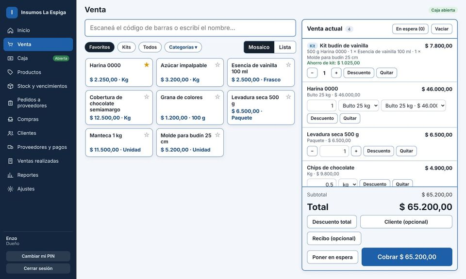
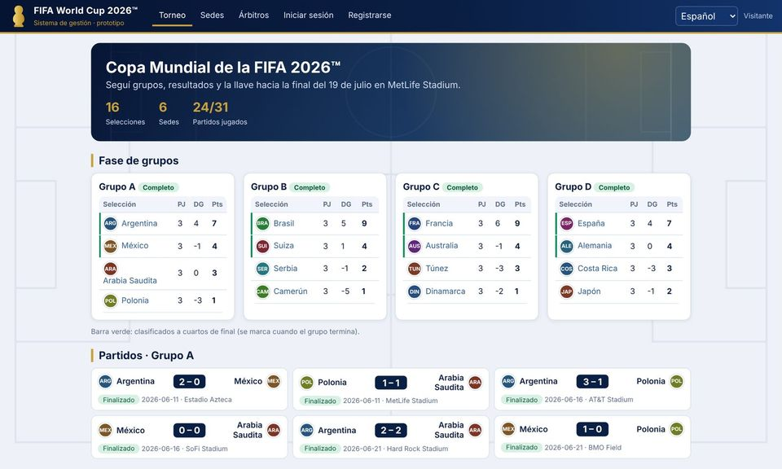

# Enzo Nicolás Acosta

**Estudiante de Ingeniería en Informática · Universidad FASTA · Mar del Plata, Argentina**

Diseño software desde los requisitos hasta las pruebas, y lo construyo con IA. 
Uno de mis sistemas se usa todos los días en un comercio real.

## Proyectos destacados

<table>
<tr>
<td width="50%" valign="top">

### POSitive · Punto de venta

App de escritorio con la que un local de insumos de panadería vende, factura y controla su stock. **En uso diario desde 2026 · v0.19.**

- Venta con lector de códigos, productos por peso y kits
- Precios con costo y % de ganancia, cuenta corriente con resumen en PDF
- Factura electrónica con ARCA (CAE y QR)
- Stock por lote con vencimientos y etiquetas con código de barras
- Funciona sin internet, con respaldo automático en la nube
- Catálogo web con precios en vivo, kits y pedidos por WhatsApp
- 75 pruebas automáticas y más de 40 recorridos de punta a punta

`Electron` `Node.js` `SQLite` `Google Apps Script` `Playwright`

[Ver video y decisiones de diseño →](https://claude.ai/artifact/6KKZTxqs7ad1FuzD71dttX#punto-de-venta)

El código es privado porque pertenece al cliente.

</td>
<td width="50%" valign="top">

### Sistema Copa del Mundo · Análisis y diseño

Trabajo anual de Ingeniería de Software: el análisis y diseño completo de un sistema para gestionar un mundial y vender sus entradas.

- Especificación de requisitos (SRS) con 4 perfiles de usuario
- Casos de uso y 22 diagramas UML
- 65 casos de prueba trazados a los requisitos
- Prototipo web con 3 roles, entradas con QR y 4 idiomas

`SRS` `UML` `Casos de uso` `Plan de pruebas` `HTML` `JavaScript`

[Ver video y proceso de diseño →](https://claude.ai/artifact/6KKZTxqs7ad1FuzD71dttX#copa-del-mundo)

</td>
</tr>
</table>

## Otros repositorios

- [Programación A](https://github.com/NicoAcosta888/Programacion-A): ejercicios de la materia en Pascal (2025).

## Con qué trabajo

**Lenguajes**

**Tecnologías**

**Ingeniería de software**

## Cómo trabajo

1. **Relevo y especifico.** Hablo con quien va a usar el sistema y lo convierto en requisitos concretos.
2. **Diseño antes de programar.** Defino el modelo de datos, las reglas de negocio y qué entra en cada etapa.
3. **Construyo por etapas.** Cada versión se puede usar y se prueba con pruebas automáticas.
4. **Reviso y corrijo.** Leo lo que se generó, detecto fallas y ajusto con lo que me dice el usuario.

## Contacto

Busco una pasantía o un primer puesto en desarrollo, diseño de software o consultoría, part-time o remoto.

- **Mail:** enzonicolasacosta@gmail.com
- **Portfolio:** https://claude.ai/artifact/6KKZTxqs7ad1FuzD71dttX
- **Idiomas:** español nativo · inglés B2 (Cambridge, 2026)
